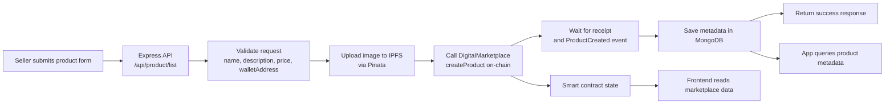

# Digital Marketplace Backend

This repository contains the backend for a blockchain-powered digital marketplace. It combines:

- an Express API written in TypeScript,
- MongoDB persistence for product metadata,
- Pinata-powered IPFS image uploads,
- a Hardhat + ethers integration layer for the on-chain marketplace contract,
- deployment and verification scripts for the Sepolia network.

The project is designed around a product listing flow where the backend accepts seller data, uploads the product image to IPFS, creates the on-chain product record, and stores the resulting metadata in MongoDB.

## Project workflow

The real workflow of the app is:

1. A seller submits product details and an image to the API.
2. The backend validates the payload and the seller wallet address.
3. The image is uploaded to IPFS through Pinata.
4. The backend calls the marketplace smart contract to create or register the product.
5. Product metadata, image URI, and transaction hash are saved in MongoDB.
6. The frontend can then read product data from the blockchain and/or the database.



> The diagram below shows the core listing flow from product submission to blockchain registration and storage.

## API flow

### Health

- `GET /api/health`

### IPFS upload

- `POST /api/ipfs/upload`
- Accepts a multipart `image` file and uploads it to Pinata.

### Product listing

- `POST /api/product/list`
- Accepts a multipart form with:
  - `name`
  - `description`
  - `price`
  - `walletAddress`
  - `image`
- The endpoint:
  - validates input,
  - uploads the product image to IPFS,
  - creates the product on-chain,
  - stores the result in MongoDB.

## Tech stack

- Node.js + TypeScript
- Express
- MongoDB + Mongoose
- Pinata SDK for IPFS uploads
- Hardhat 3
- ethers v6
- OpenZeppelin contracts

## Repository layout

```text
contracts/         Solidity contracts and tests
ignition/          Hardhat Ignition deployment modules
scripts/           standalone scripts
src/               Express app, controllers, routes, services, config
test/              Hardhat/TypeScript tests
artifacts/         compiled contract artifacts
cache/             build cache
```

## Local setup

Install dependencies:

```bash
npm install
```

Create a `.env` file in the project root or configure the values used by `src/config/key.ts`.

Typical variables include:

```bash
PORT=8001
MONGO_URI=your_mongodb_connection_string
JWT_SECRET=your_jwt_secret
PINATA_API_KEY=your_pinata_key
PINATA_API_SECRET=your_pinata_secret
PRIVATE_KEY=your_backend_wallet_private_key
MARKETPLACE_CONTRACT_ADDRESS=your_deployed_contract_address
RPC_URL=https://ethereum-sepolia-rpc.publicnode.com
PHX_TOKEN_DECIMALS=18
```

## Run the application

Start the API in development mode:

```bash
npm run dev:api
```

This starts the Express server from `src/index.ts` and connects to MongoDB before serving requests.

## Contract and blockchain workflow

Compile contracts:

```bash
npm run compile
```

Start a local Hardhat node:

```bash
npm run chain
```

Deploy the marketplace using Ignition:

```bash
npx hardhat ignition deploy ignition/modules/DigitalMarket.ts --network sepolia --parameters ignition/parameters.json
```

The deployment script uses the `DigitalMarketplace` module and passes the token address expected by the contract.

## Useful scripts

```bash
npm run dev:api        # start the API with tsx watch
npm run build:api      # TypeScript check without emitting files
npm run compile        # compile Solidity contracts
npm run chain          # start Hardhat local chain
npm run chain:test     # run the contract test script against Sepolia
npm run chain:deploy   # deploy the marketplace contract to Sepolia
npm run chain:verify   # verify the deployed contract
```

## Notes

- The backend currently uses the wallet address supplied in the request body as the seller reference during listing. In production, this should be replaced with a proper authenticated wallet/session check.
- IPFS uploads rely on the Pinata API credentials configured in the environment.
- Blockchain interactions are wired through the contract ABI in `src/abi/DigitalMarketplace.json` and the service layer in `src/services/marketPlace.ts`.

## Example listing flow

```bash
curl -X POST http://localhost:8001/api/ipfs/upload \
  -F "image=@./sample-product.png"

curl -X POST http://localhost:8001/api/product/list \
  -F "name=Sample Product" \
  -F "description=Digital collectible item" \
  -F "price=0.5" \
  -F "walletAddress=0xYourWalletAddress" \
  -F "image=@./sample-product.png"
```

This is the core marketplace request path the project is built around.
